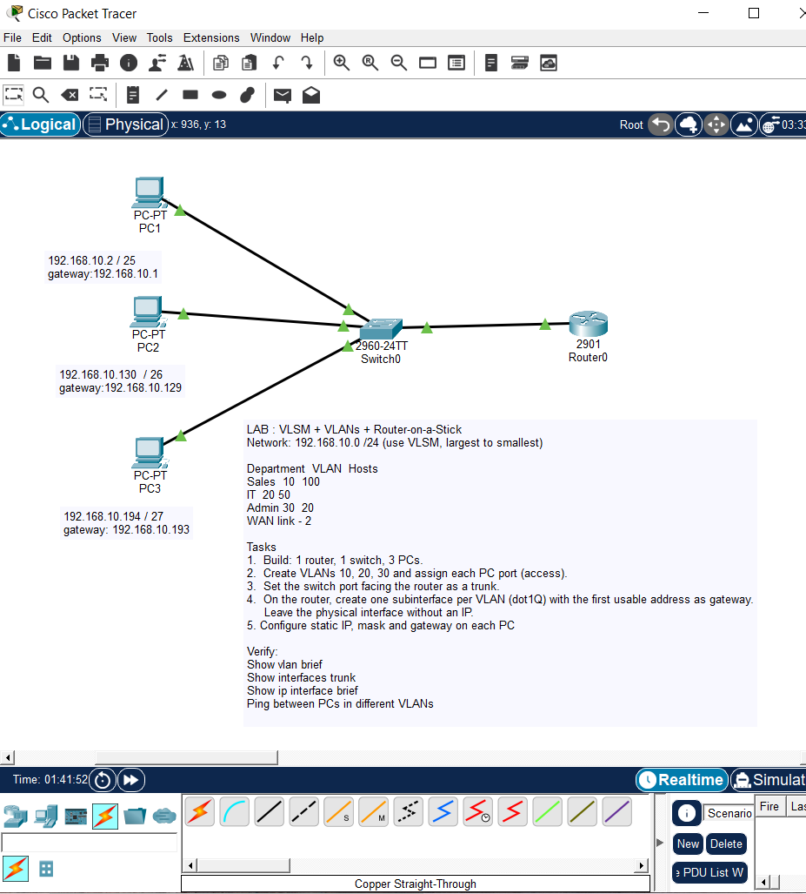
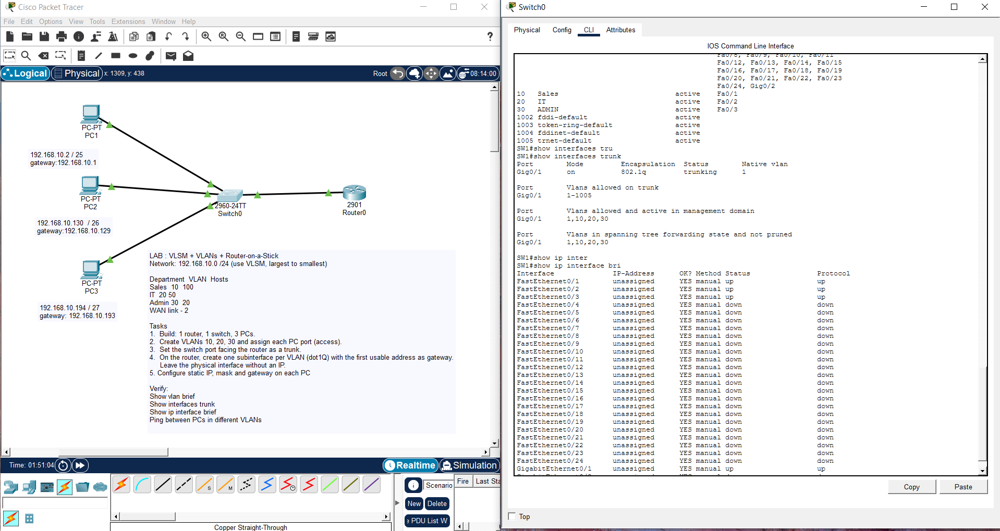
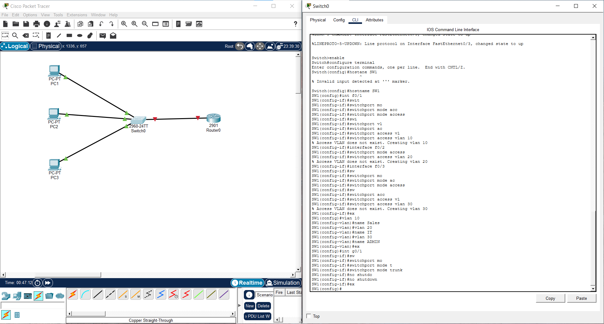
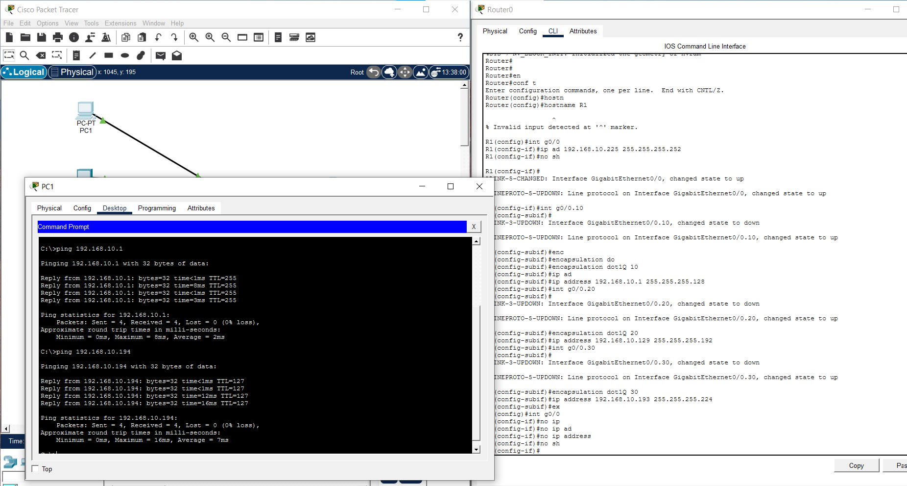

# VLSM + VLANs + Router-on-a-Stick

## Objective
Divide the network 192.168.10.0/24 using VLSM, then enable
communication between VLANs with router-on-a-stick.

## Topology


## Addressing table
| Network | VLAN | Subnet | Mask | Usable range | Broadcast |
|---|---|---|---|---|---|
| Sales (100 hosts) | 10 | 192.168.10.0/25 | 255.255.255.128 | .1 - .126 | .127 |
| IT (50 hosts) | 20 | 192.168.10.128/26 | 255.255.255.192 | .129 - .190 | .191 |
| Admin (20 hosts) | 30 | 192.168.10.192/27 | 255.255.255.224 | .193 - .222 | .223 |
| WAN link (2 hosts) | - | 192.168.10.224/30 | 255.255.255.252 | .225 - .226 | .227 |

Method: allocate from the largest need to the smallest, and start
each subnet right after the previous broadcast address.

## Devices
| Device | IP | Mask | Gateway |
|---|---|---|---|
| PC1 (Sales) | 192.168.10.2 | 255.255.255.128 | 192.168.10.1 |
| PC2 (IT) | 192.168.10.130 | 255.255.255.192 | 192.168.10.129 |
| PC3 (Admin) | 192.168.10.194 | 255.255.255.224 | 192.168.10.193 |

## Configuration
Switch: VLANs 10, 20, 30 created, Fa0/1-3 in access mode,
Gig0/1 in trunk mode.

Router: physical interface g0/0 has no IP address.
One subinterface per VLAN:
```
interface g0/0.10
 encapsulation dot1Q 10
 ip address 192.168.10.1 255.255.255.128
interface g0/0.20
 encapsulation dot1Q 20
 ip address 192.168.10.129 255.255.255.192
interface g0/0.30
 encapsulation dot1Q 30
 ip address 192.168.10.193 255.255.255.224
```

## Verification



Ping from PC1 (Sales) to PC3 (Admin) succeeds:



The TTL is 127. A Windows PC starts at 128, and each router
removes 1, so the packet crossed the router.

## Problems and fixes
- **IP on the physical interface.** I first set an IP on g0/0.
  Fix: the physical interface has no IP. The IPs go on the
  subinterfaces, because one cable carries tagged traffic
  for all VLANs.
- **Wrong WAN mask.** I wrote 255.255.255.228. The correct mask
  is 255.255.255.252 (block size 4, so 256 - 4 = 252).
  A mask is always a block of 1s followed by 0s, so 228 is invalid.
-**Valid subnet mask.** Now i nkow that these are the only valid mask values: 128, 192, 224, 240, 248, 252, 254, 255 and 0.
   Any other value, like 228, is not a valid mask.

## What I learned
- VLSM splits one network into subnets of different sizes,so I avoid wasting addresses.
- I allocate the largest subnet first, and each new subnet starts right after the previous broadcast address.
- Router-on-a-stick lets separate VLANs communicate with each other through one trunk link.

## Files
- `vlsm-vlan-lab.pkt`: Packet Tracer file
- `screenshots/`: proofs of the configuration 