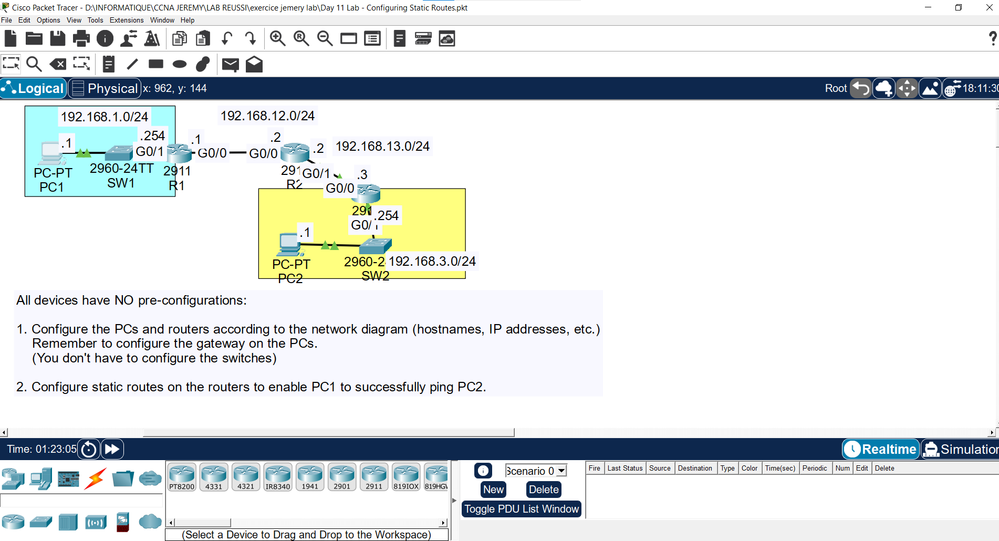
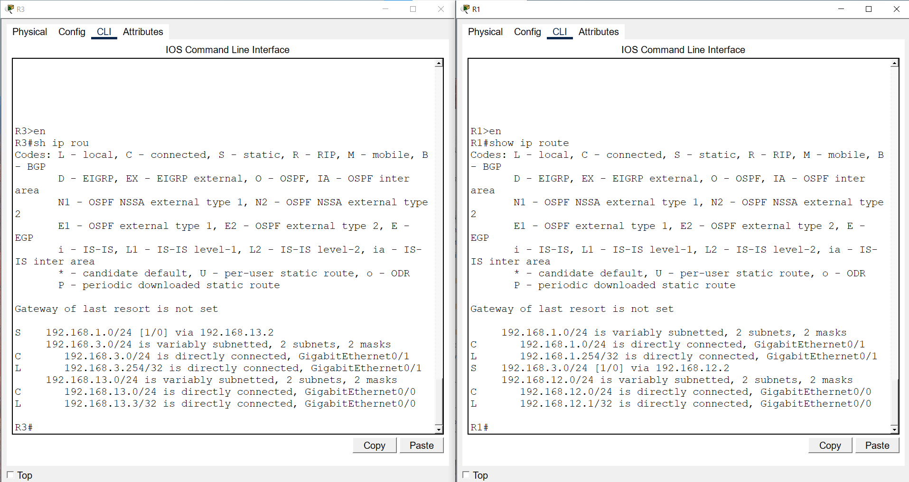
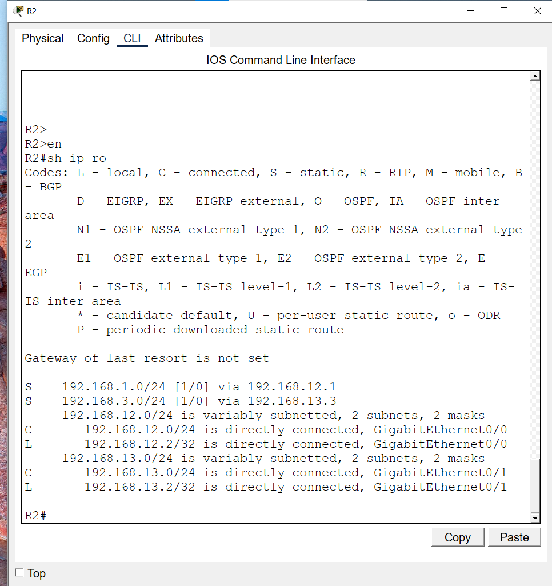
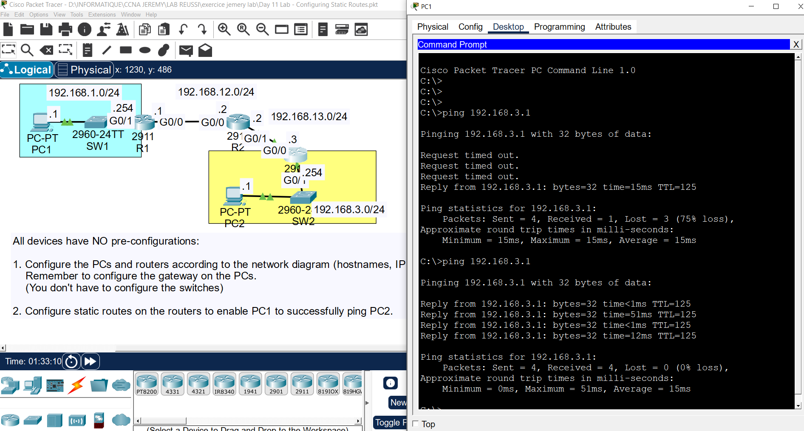

# Static Routes (3 routers)

## Objective
Configure static routes so PC1 (192.168.1.0/24) can ping PC2 (192.168.3.0/24)
trought three routers.

## Topology




## Addressing table
|  Device | Interface | IP address | Mask | Gateway |
|---|---|---|---|---|
|PC1  | NIC | 192.168.1.1 | 255.255.255.0 | 192.168.1.254 |
|R1  | G0/1 | 192.168.1.254 | 255.255.255.0 | - |
|R1  | G0/0 | 192.168.12.1 | 255.255.255.0 | - |
|R2  | G0/0 |192.168.12.2  | 255.255.255.0 | - |
|R2  | G0/1 |192.168.13.2  | 255.255.255.0 | - |
|R3  | G0/0 |192.168.13.3  | 255.255.255.0 | - |
|R3  | G0/1 | 192.168.3.254 | 255.255.255.0 | - |
| PC2 | NIC | 192.168.3.1 | 255.255.255.0 | 192.168.3.254 |

## Static routes
| Router | Destination network | Next hop |
|---|---|---|
|R1  | 192.168.3.0/24 | 192.168.12.2 |
|R2  | 192.168.1.0/24 | 192.168.12.1 |
|R2  | 192.168.3.0/24 | 192.168.13.3 |
|R3  | 192.168.1.0/24 | 192.168.13.2 |    

Command format : 
```
ip route <destination network> <mask> <next hop>
```

A router only knows its directly connected networks.
Static routes are needed in both directions: without the return route, the reply never comes back.

## Verification 










The TTL is 125: PC1 starts at 128 and the packet crossed 3 routers.

## Problems and fixes
- I forget how to configure static routes. After many mistakes 
  and some reading, i fixed it and memorized the correct command. 

## What I learned
- i reviewed the route codes: L (local), S (static), and
  C(directly connected)
- I memorized the command to configure a static route: 
  `ip route <destination network> <mask> next hop>`

## Files 
- `static-routes-lab.pkt`: Packet Tracer file
- `screenshots/`: proofs of the configuration