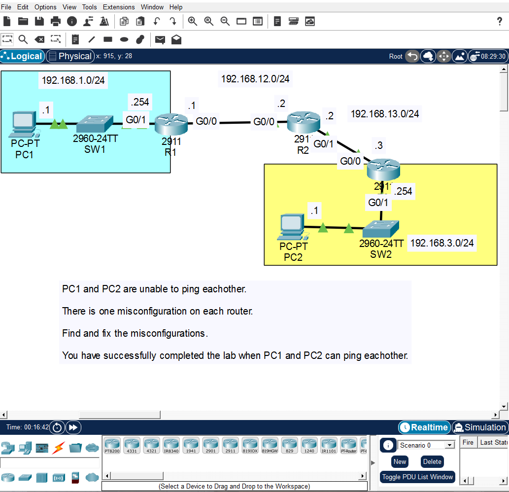
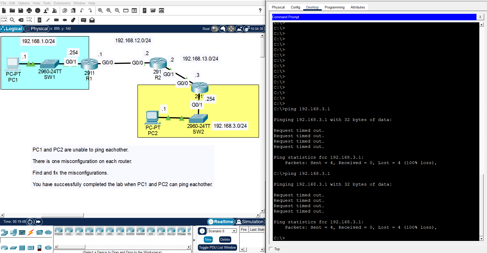
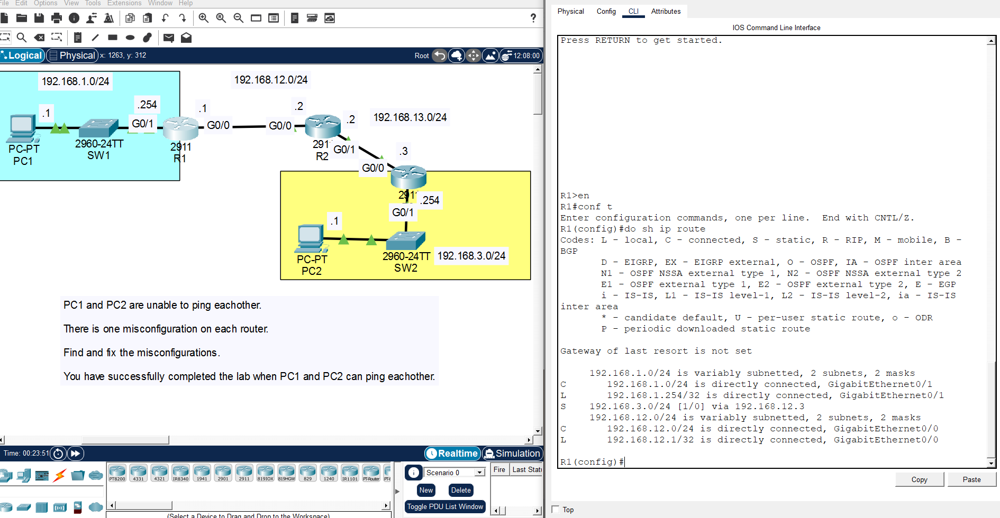
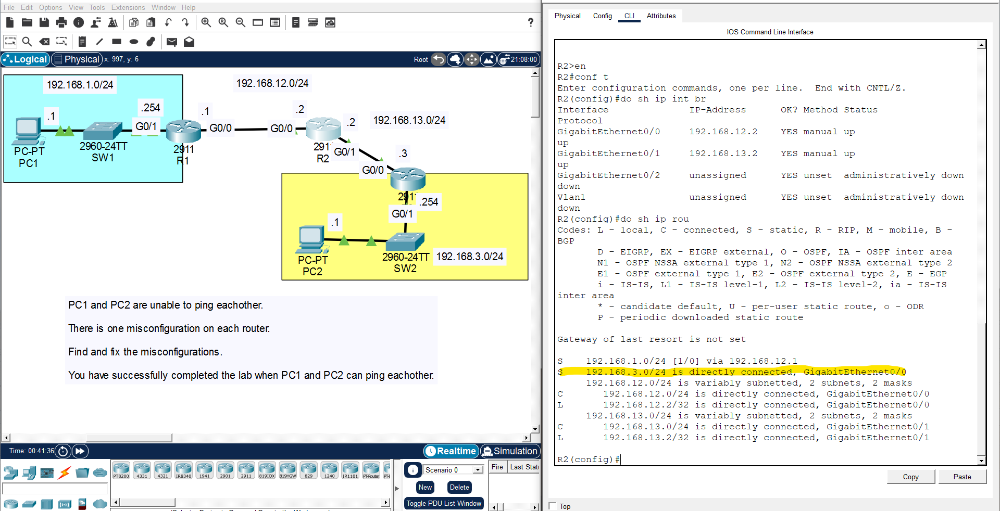
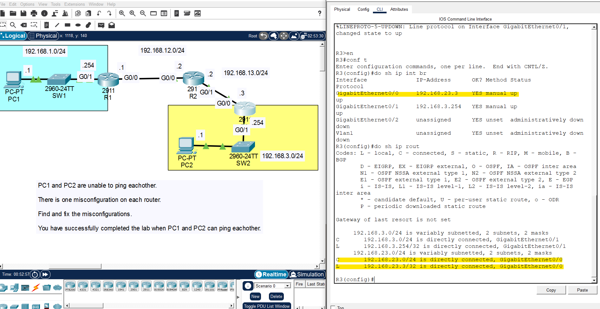
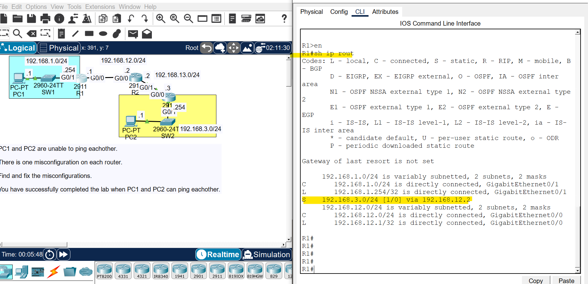
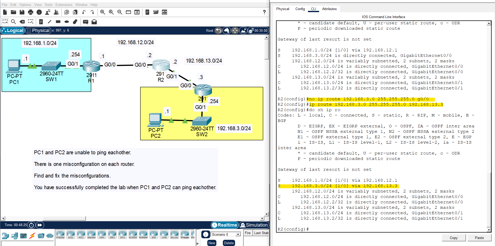
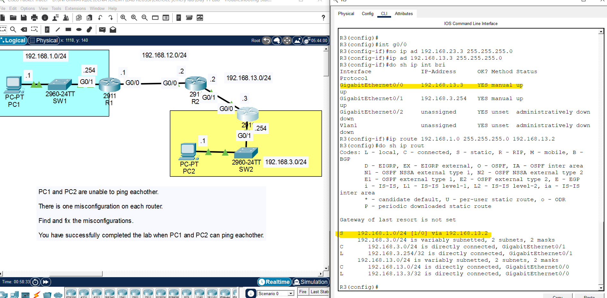
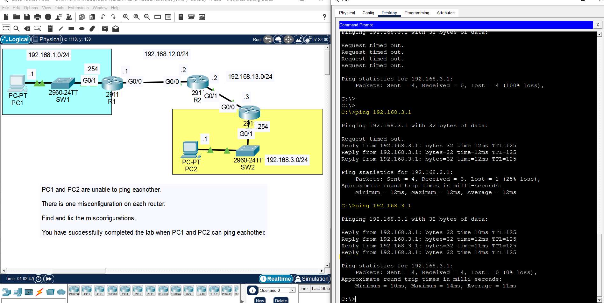

# Troubleshooting Static Routes

## Objective 
PC1 and PC2 cannot ping each other. There is one misconfiguration
on each router. Find and fix them.

##Topology 





## Before the fix 














## Troubleshooting

| Router | Problem found | Found with | Fix |
|---|---|---|---|
| R1 | Wrong next hop (192.168.12.3) | `show ip route` | Next hop 192.168.12.2 |
| R2 | Route uses exit interface G0/0 | `show ip route` | Next hop 192.168.13.3 |
| R3 | Wrong IP on G0/0 (192.168.23.3) | `show ip interface brief` | IP 192.168.13.3 |
| R3 | Missing return route to 192.168.1.0/24 | `show ip route` | Add the static route |

## Commands used

R1:
```
no ip route 192.168.3.0 255.255.255.0 192.168.12.3
ip route 192.168.3.0 255.255.255.0 192.168.12.2
```
R2:
```
no ip route 192.168.3.0 255.255.255.0 GigabitEthernet0/0
ip route 192.168.3.0 255.255.255.0 192.168.13.3
```

R3:
```
interface g0/0
 ip address 192.168.13.3 255.255.255.0
exit
ip route 192.168.1.0 255.255.255.0 192.168.13.2
```

## After the fix












## What I learned
- A next hop must be an address in a directly connected network.
- A static route is not installed if its next hop is unreachable.
- Check the interface IP addresses before checking the routes.

## Files
- `troubleshooting-static-routes-lab.pkt`: Packet Tracer file
- `screnshots/`: proofs before and after the fix