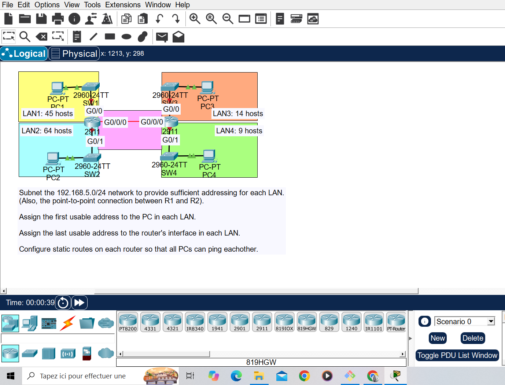
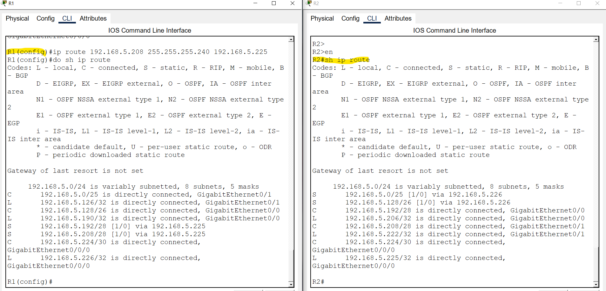
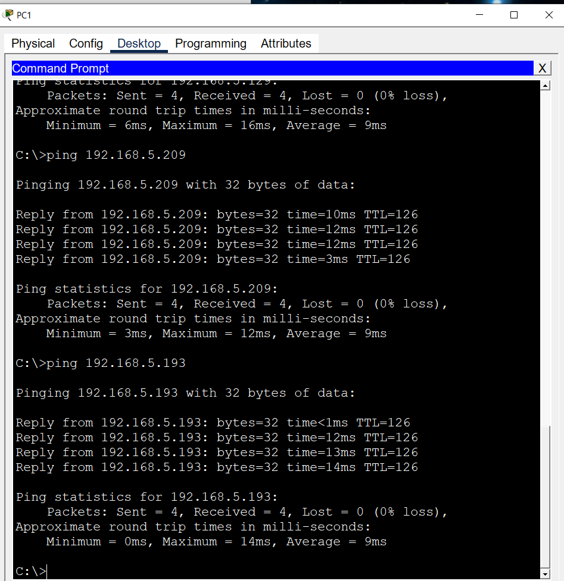

# VLSM Subnetting and Static Routing Lab

## Objective
Design a non-overlapping VLSM subnetting scheme for multiple LANs and a point-to-point router link.
Configure IP addressing and static routes on R1 and R2, and verify end-to-end connectivity.

## Topology

## Configuration
| Device | Interface | IP Address | Subnet Mask | Notes / Role |
| :--- | :--- | :--- | :--- | :--- |
| R1 | G0/1 | 192.168.5.126 | 255.255.255.128 | LAN2 gateway (64 hosts, /25) |
| R1 | G0/0 | 192.168.5.190 | 255.255.255.192 | LAN1 gateway (45 hosts, /26) |
| R2 | G0/0 | 192.168.5.206 | 255.255.255.240 | LAN3 gateway (14 hosts, /28) |
| R2 | G0/1 | 192.168.5.222 | 255.255.255.240 | LAN4 gateway (9 hosts, /28) |
| R1 | G0/0/0 | 192.168.5.226 | 255.255.255.252 | R1-R2 link (/30) |
| R2 | G0/0/0 | 192.168.5.225 | 255.255.255.252 | R1-R2 link (/30) |
| PC1 | NIC | 192.168.5.129 | 255.255.255.192 | LAN1 host (first usable, /26) |
| PC2 | NIC | 192.168.5.1 | 255.255.255.128 | LAN2 host (first usable, /25) |
| PC3 | NIC | 192.168.5.193 | 255.255.255.240 | LAN3 host (first usable, /28) |
| PC4 | NIC | 192.168.5.209 | 255.255.255.240 | LAN4 host (first usable, /28) |

## Verification
- Routing table check:

- Connectivity check (ping):

## What I learned
- How to allocate subnets efficiently with VLSM from largest host requirement to smallest without address overlap.
- How to verify directly connected and static routes using `show ip route` and test reachability with `ping`.

## Files
- `vlsm-static-routes-lab.pkt`: Cisco Packet Tracer lab file
- `screenshots/`: Verification screenshots (`topology`, `routing-table`, `ping-result`)